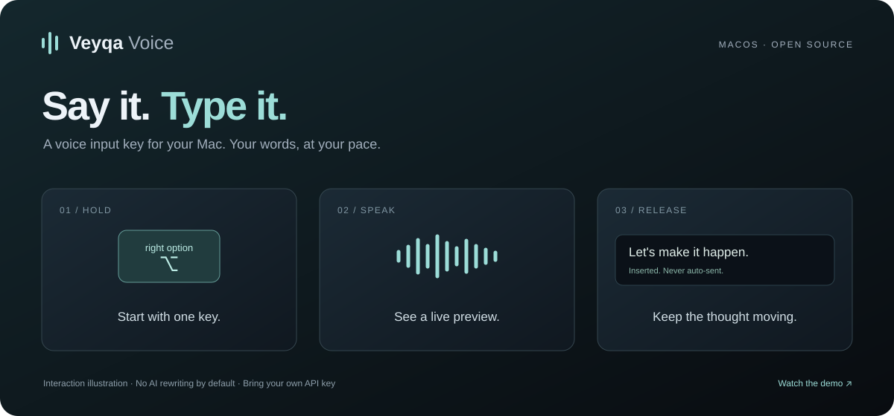

# Veyqa Voice

**Lightweight voice input for Mac. Hold to speak, release to type.**

[Website](https://wjc-dev.github.io/veyqa-voice/) · [Download](https://github.com/wjc-dev/veyqa-voice/releases/tag/v0.2.18) · [简体中文](README.md)

[](https://wjc-dev.github.io/veyqa-voice/#demo)

- Works alongside your existing keyboard and input method.
- Transcribes your words into the focused input field; you decide when to send.
- Supports Qwen and Doubao. Add terms such as `user_id` and `seller_id` to improve recognition.
- Try the built-in service during the promotion without an account or API Key, or bring your own API credentials.

## Install

Requires **Apple Silicon and macOS 13+**.

1. [Download and open the DMG](https://github.com/wjc-dev/veyqa-voice/releases/download/v0.2.18/Veyqa-Voice-v0.2.18-macOS-arm64.dmg).
2. Follow the arrow: drag **Veyqa Voice into Applications**.
3. Open Veyqa Voice from Applications to begin setup.

For an unidentified-developer prompt, open System Settings → Privacy & Security → Open Anyway. [See Apple's guide](https://support.apple.com/en-us/102445).

Or install with Homebrew:

```bash
brew install --cask wjc-dev/veyqa/veyqa-voice
```

## Updating

Open Settings → General → App → Check for Updates, then download and relaunch. New versions are checked daily by default. Your API credentials and settings are retained; no uninstall is needed.

Version 0.2.8 and earlier need one manual upgrade using Homebrew or the DMG before in-app updates become available.

Alternatively, quit the app and update with Homebrew:

```bash
brew update
brew upgrade --cask wjc-dev/veyqa/veyqa-voice
```

For DMG installations, download the new installer above, drag the app into Applications and choose Replace. Follow the in-app guide if macOS asks you to confirm permissions.

## Set up once

1. Connect to the default built-in service; no account or API Key is required. You can also [use your own Key](https://wjc-dev.github.io/veyqa-voice/#api-key).
2. Grant microphone, Accessibility, and Input Monitoring permissions. Return to the app for automatic checks. Follow macOS prompts if it requests a relaunch.
3. Click the trial text field, hold **right Option** to speak, then release. Finish setup and use it in other apps.

Open settings from the menu bar or reopen the app from Applications. New installations stay out of the Dock; enable Dock visibility in General if preferred. Adjust the shortcut and hold/toggle mode, then save to apply. Updates preserve existing configuration.

## Speech services

The built-in service uses **Qwen Audio 3.1 ASR Message** (`qwen-audio-3.1-asr-flash-message`) with live transcription and text polishing off by default, paid for by Veyqa Voice during the promotion. Existing users keep their personal credentials and model when upgrading; switch to built-in service in Settings → Speech Service.

With your own API credentials, choose Qwen or Doubao models and refresh their official catalogues, or add an OpenAI-compatible provider. Qwen and Doubao stream live; custom providers transcribe when recording ends.

Audio goes directly to the selected speech service. Personal API credentials stay on your Mac and usage is billed to your provider account. Local audio archives are off by default.

[Issues](https://github.com/wjc-dev/veyqa-voice/issues) · [Development](docs/development.md) · [Contributing](.github/CONTRIBUTING.md) · [Security](.github/SECURITY.md)

## License

[MIT](LICENSE). Derived from [ErlichLiu/Whisper-Input](https://github.com/ErlichLiu) and [Mor-Li/Whisper-Input-Next](https://github.com/Mor-Li), with original copyright notices retained.
